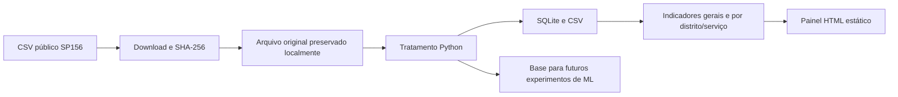

# Arquitetura do ResolveBairro

## Implementado nesta versão

O tratamento filtra quatro serviços, padroniza datas, preserva os status e calcula duração somente para solicitações finalizadas com datas válidas. Dados sem suporte ficam nulos. A proveniência é registrada com a URL e hash da fonte. Não existe ingestão contínua.

O SQLite armazena chamados e metadados, com views de fila pendente e treinamento. CSVs apoiam análise e integração. O painel contém métricas embutidas; não consulta o SQLite ou atualiza a base automaticamente. Não há backend em execução.

## Componentes propostos, ainda não implementados

1. Notebook com pelo menos dois modelos, validação temporal e avaliação final fora da amostra.
2. Serviço de inferência com modelo e pré-processamento versionados, disponível somente depois da validação.
3. API para cadastro, acompanhamento e consulta de indicadores, com autorização e persistência transacional.
4. Interface conectada à API e controles de acesso para gestão.
5. Monitoramento de erro e de diferenças territoriais e registro das revisões humanas.

Prazos oficiais por serviço são necessários antes de calcular atraso. Pesquisas de resultado são necessárias para satisfação. A base permite modelar tempo de finalização administrativa, não comprova resolução efetiva. Não se deve apresentar nenhuma previsão como prazo oficial nem utilizar prioridade automática sem análise de impacto.
